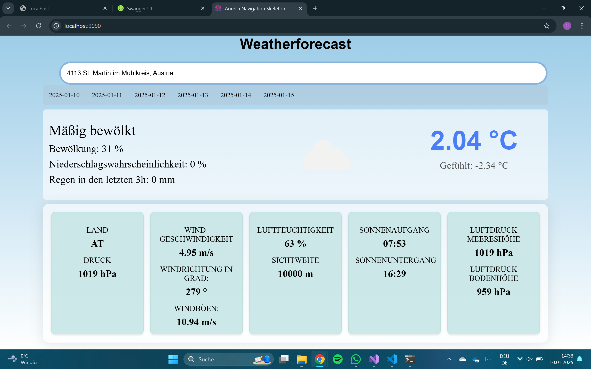
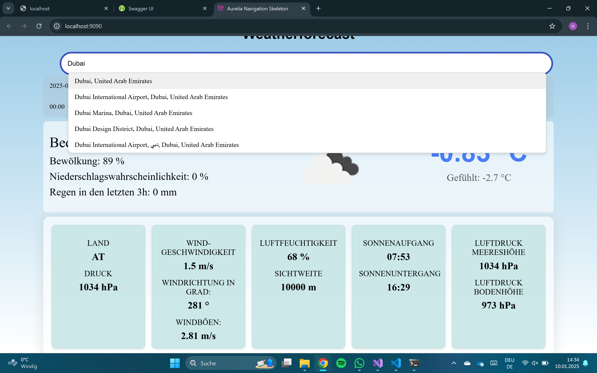

# WeatherForecast Project

**by Hofer Irene**

A web application consisting of an **Aurelia frontend** and an **ASP.NET Web API backend**.


## Screenshots

### Weather Forecast



### Forecast Details



## External APIs

- **[OpenWeather API](https://openweathermap.org/api):** Provides weather data
- **[Geoapify Geocoding API](https://www.geoapify.com/geocoding-api):** Provides location autocomplete


## Setup

### 1. Start the Backend

Navigate to the backend project folder:

```text
02_WeatherForecast/02_WeatherForecast
```

Open a terminal in this folder and run:

```bash
dotnet run
```

The backend will be available at:

```text
http://localhost:5118
```

### 2. Start the Frontend

Navigate to the frontend project folder:

```text
04_Weatherforecast
```

Install the dependencies:

```bash
npm install
```

Start the Aurelia development server:

```bash
au run
```

The frontend will be available at:

```text
http://localhost:9090/
```
